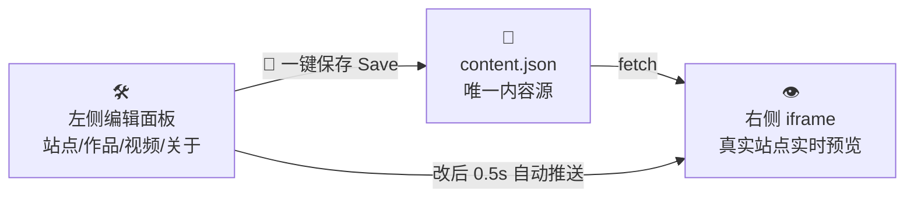

<div align="center">

# 🎨 Craftfolio

**AIGC 创作者个人站模板 · A Portfolio Template for AI Creators**

无需后端、无需数据库 —— 改一个 JSON 文件，就能拥有一个双语、多主题、可视化编辑的个人作品站。
No backend, no database — edit one JSON file and own a bilingual, multi-theme portfolio with a visual workshop.


**🚀 [快速开始 Quick Start](#-quick-start-三分钟上手) · 🛠 [内容工坊 Workshop](#️-content-workshop-内容工坊) · ☁️ [部署上线 Deploy](#️-deploy-上线部署) · ❓ [FAQ](#-faq-常见问题)**

</div>

---

## 📖 这是什么？What is this?

一个为 **AI创作者 / 设计师 / 独立开发者** 准备的作品集模板：

> 左侧编辑、右侧实时预览的「内容工坊」+ 一键保存落盘 + 中英双语 + 5 套主题 + B 站视频内嵌。
> A split-view visual workshop (edit left, live-preview right) + one-click save + zh/en bilingual + 5 themes + inline Bilibili videos.

**它特别适合你，如果你** / *It fits you if*：

| | 你是谁 You are | 你能得到 You get |
| --- | --- | --- |
| 🧑‍🎨 | AI 画师 / 视频创作者 | 作品集 + 视频墙 + 委托入口 |
| 🧑‍💻 | 想要个人站的开发者 | 纯前端、零运维、免费部署 |
| 🧑‍🏫 | 完全不懂代码的小白 | 全程可视化编辑，不碰代码也能建站 |

## ✨ Features 特性一览

| 图标 | 特性 Feature | 说明 Description |
| --- | --- | --- |
| 🖥️ | **4 个页面 Pages** | 首页长滚动（Hero/作品/视频/服务/数据/CTA）+ 作品集 + 视频 + 关于 |
| 🌗 | **中英双语 Bilingual** | 所有文案一键切换，即时生效，无刷新 |
| 🎨 | **5 套主题 Themes** | 极光霓虹 / 赛博网格 / 暗金质感 / 极简纸白 / 落日渐变，导航栏一键换装 |
| 🛠️ | **可视化工坊 Workshop** | 左边编辑表单，右边真实站点实时预览，改完点「保存」直接写回文件 |
| 🖼️ | **图片三通道 Images** | 填路径 / 本地上传（自动压缩入库）/ 图库点选，还能调不透明度、位置、缩放 |
| 📺 | **B 站视频 Bilibili** | 封面 + 播放按钮，点击才加载 iframe，国内访问零障碍 |
| 🏷️ | **自由标签 Tags** | 作品按标签自动聚合筛选 |
| 📦 | **零依赖部署 Zero-cost** | 纯静态输出，Vercel 免费托管，无服务器费用 |
| 🔍 | **SEO 基础** | meta / OG 标签内置，SPA 路由 Vercel rewrites 兜底 |

<div align="right"><a href="#-craftfolio">⬆ 回到顶部 Top</a></div>

## 🚀 Quick Start 三分钟上手

### 0️⃣ 准备 Prepare

| 需要 Require | 版本 Version | 检查命令 Check |
| --- | --- | --- |
| [Node.js](https://nodejs.org/)（含 npm） | **≥ 18** | `node -v` |

> 💡 **TIP**：装 Node.js 时一路「下一步」即可，其他什么都不用装。 / *Just install Node.js with defaults — nothing else needed.*

### 1️⃣ 安装 Install

```bash
git clone https://github.com/ruyunai/Craftfolio.git my-site
cd my-site
npm install        # 第一次需要等 1-2 分钟
```

### 2️⃣ 启动 Run

```bash
npm run dev        # 启动开发服务器
```

打开浏览器访问 **http://localhost:5173** —— 站点已经跑起来了！🎉
Open **http://localhost:5173** in your browser — your site is live! 🎉

### 3️⃣ 打开工坊 Open the Workshop

浏览器访问 **http://localhost:5173/workshop**（或点导航栏的「🛠 工坊」），进入可视化编辑模式 ↓

<div align="right"><a href="#-craftfolio">⬆ Top</a></div>

---

## 🛠 Content Workshop 内容工坊

**这是本模板的招牌功能**：不需要碰任何代码，像填表格一样装修你的网站。/ *The signature feature: decorate your site like filling a form — no code involved.*



| 区块 Block | 能做什么 What you can do |
| --- | --- |
| 🧭 **工具条 Toolbar** | 预览页签切换、语言（中/EN）、5 套主题、视口模拟（🖥桌面 / ▭平板 / ▯手机）、**💾 保存**、导入 / 下载 / 重置 |
| 📝 **左侧编辑区 Left** | 站点信息 / 导航页脚 / 首页区块（增删排序）/ 作品 / 视频 / 关于 / JSON 源码，共 7 个面板，中英同屏编辑 |
| 👁 **右侧预览区 Right** | 真实站点在 iframe 里运行——主题切换、响应式、视频播放全部保真；还能直接点击预览里的导航 |

### 🖼️ 图片怎么换？Images in 3 ways

| 方式 Way | 操作 How | 适合 Suit for |
| --- | --- | --- |
| 🔗 **填路径** | 直接输入 `/assets/images/xxx.jpg` 或外链 URL | 图已在项目里 |
| ⬆️ **上传本地图片** | 点「上传本地图片」选文件 → 自动压缩（最长边 1920px）→ 存入 `public/assets/images/` | 手机/电脑里的原图 |
| 🖼️ **图库点选** | 点「图库」→ 网格里点一下已入库的图片 | 复用已上传的图 |

> ✨ 上传的图片还可以展开「**调整显示**」：不透明度、位置、缩放、偏移全部滑块可调，右侧即时预览。
> *Uploaded images also support opacity / position / zoom / offset sliders with live preview.*

### 💾 保存与恢复 Save & Restore

- 点右上角 **「保存」** → 直接写回 `public/content/content.json`（改坏了？上一版自动备份在 `public/content/content.backup.json`）。
- **「下载 content.json」** 可离线导出一份；**「重置」** 放弃所有未保存编辑回到磁盘版本。

<div align="right"><a href="#-craftfolio">⬆ Top</a></div>

---

## ✏️ 填入你自己的内容 Your Content

**方式 A（推荐推荐推荐）**：`npm run dev` → 打开 `/workshop` → 左改右看 → 点「保存」。**全程不用碰代码。**

**方式 B**：直接编辑 [`public/content/content.json`](public/content/content.json)（唯一内容源），改完跑 `npm run check` 自检。

字段速查 / Field reference：

| 键 Key | 内容 Content |
| --- | --- |
| `site` | 站名、SEO 描述、logo、社交链接（bilibili / 小红书 / 抖音 / X / GitHub / 邮箱）、联系邮箱 |
| `nav` | 顶部导航菜单 |
| `footer` | 版权、页脚链接、AI 内容披露声明、备案号 |
| `home.sections` | 首页区块，`type` 支持 `hero / works / video / services / stats / ctaBanner` |
| `works.items` | 作品：标题、年份、标签（即筛选标签）、封面、描述、外链 |
| `videos.items` | 视频：B 站 `bvid`（或完整链接）、分 P、封面、标签 |
| `about` | 头像、简介、能力雷达、工具链、创作历程、合作方式 |

> 💡 **TIP**：改完 JSON 记得跑 `npm run check`，它会帮你检查结构、图片引用和 B 站 BV 号格式。

## 🎨 Themes 五套主题

导航栏右上角一键切换，`localStorage` 自动记忆用户选择。想加自己的主题？两步搞定：在 `src/styles/tokens.css` 加一段变量 + 在 `src/composables/useContent.js` 的 `PRESETS` 注册即可。

| 预设 Preset | 风格 Style | 主色 Accent |
| --- | --- | --- |
| 🌌 `aurora` | 极光霓虹 · 暗夜科技感 | 紫青渐变 |
| 🕸️ `cyber` | 赛博网格 · 电子朋克 | 电光蓝 |
| 🏆 `gold` | 暗金质感 · 高级杂志 | 香槟金 |
| 📄 `paper` | 极简纸白 · 印刷排版 | 墨黑 |
| 🌅 `sunset` | 落日渐变 · 温暖治愈 | 橙粉 |

<div align="right"><a href="#-craftfolio">⬆ Top</a></div>

---

## ☁️ Deploy 上线部署

纯静态产物，三大平台均可**免费**托管，任选其一，也可以多平台双保险：

| 平台 Platform | 免费额度 Free tier | 国内访问 Access | 适合 Suitable for |
| --- | --- | --- | --- |
| 🔷 **Vercel** | 长期免费 Hobby 计划 | 一般（常需 Cloudflare 中转） | 国际访客为主 |
| 🟠 **Cloudflare Pages** | 500 次构建/月，静态请求与带宽不设限 | 良好（绑定自定义域名后） | 免运维 + 双保险 |
| 🐧 **腾讯云 EdgeOne Pages** | 官方承诺「免费版永久提供」 | ⭐ 最好（中国大陆边缘节点） | 国内访客为主 |

### 🔁 SPA 路由重写（重要 Important）

本站使用 History 路由，必须把所有未匹配路径回退到 `index.html`，否则直接刷新 `/works` 会 404：

- ✅ **已内置，无需操作**：模板自带的 `public/_redirects`（内容 `/* /index.html 200`）—— Cloudflare Pages 与 EdgeOne Pages 部署后开箱即用；
- Vercel 不读取该文件（自动忽略），它使用内置的 `vercel.json` rewrites，同样已配置好。

### 方式 A：Vercel + GitHub

1. 把本仓库推到**你自己的** GitHub 仓库（见下方命令）；
2. 打开 [vercel.com](https://vercel.com) → **Add New → Project → Import** 你的仓库；
3. Vercel 会自动识别 Vite —— 直接点 **Deploy**，10 秒后拿到 `xxx.vercel.app` 网址 🎉

```bash
git init
git add -A
git commit -m "feat: my portfolio"
git branch -M main
git remote add origin https://github.com/<你的用户名>/<仓库名>.git
git push -u origin main
```

### 方式 B：Cloudflare Pages

1. 登录 [dash.cloudflare.com](https://dash.cloudflare.com) → **Workers & Pages → Create → Pages → Connect to Git**；
2. 授权并选择你的 GitHub 仓库；
3. 构建配置：框架选 **Vue**（Vite）—— 构建命令 `npm run build`、输出目录 `dist`、Node 18+；
4. 点 **Deploy**，一分钟后拿到 `xxx.pages.dev` 网址 🎉（SPA 重写已由 `_redirects` 内置）；
5. 自定义域名：项目 **Custom domains** 添加，按提示加 CNAME 记录即可。

### 方式 C：腾讯云 EdgeOne Pages（国内访客首选 🇨🇳）

1. 登录 [EdgeOne Pages 控制台](https://edgeone.cloud.tencent.com/pages) → **创建项目 → 导入 Git 仓库**，授权 GitHub；
2. 构建配置：构建命令 `npm run build`、输出目录 `dist`、Node 18+；
3. 点部署 —— SPA 重写已由 `_redirects` 内置（EdgeOne 兼容该语法），默认域名即可访问 🎉
4. 自定义域名：项目「域名管理」添加，按提示加 CNAME；**要使用中国大陆加速节点，域名需完成 ICP 备案**；
5. 免费政策（官方定价页原文）：「免费版本将永久提供」「推出收费版之前，即使超出用量限制也不会中断服务」。

> 💡 **双保险建议**：同一个仓库可以同时接入多个平台（比如主用 EdgeOne、Cloudflare / Vercel 做备份）—— 纯静态站点迁移零成本，哪个平台出问题随时切换。

<div align="right"><a href="#-craftfolio">⬆ Top</a></div>
### 🧹 上线前替换占位 Before you go live

| 占位内容 Placeholder | 位置 Where |
| --- | --- |
| B 站视频 `BV1GJ411x7h7` | `content.json` 的 `home` / `videos` |
| 社交链接（`space.bilibili.com/1800000` 等示例） | `content.json` 的 `site.socials` |
| 备案号 `浙ICP备XXXXXXXX号` | `content.json` 的 `footer.beian` |
| 联系邮箱 `hello@qishi.studio` | `content.json` 的 `site.contactEmail` |
| 16 张 SVG 示例图 | `public/assets/images/`（同名替换或在工坊上传） |

<div align="right"><a href="#-craftfolio">⬆ Top</a></div>

---

## 🧪 质量自检 Quality Checks

改完内容或代码后，跑这三条命令，全绿即可放心发布：

```bash
npm run check          # 校验 content.json 结构 / 图片引用 / BV 号格式
npm run build          # 生产构建（必须无错误）
npm run test:smoke     # 真浏览器冒烟 51 项（需先 npm run preview；系统 Edge/Chrome 驱动）
npm run test:workshop  # 内容工坊冒烟 27 项（自动起 dev server，无需手动启动）
```

## 📁 Project Structure 目录结构

```text
📦 craftfolio
├─ 📁 public/
│  ├─ 📁 content/
│  │  ├─ 📄 content.json      ← 🌟 全站唯一内容源（改这里 or 用工坊）
│  │  └─ 📄 content.backup.json ← 💾 每次保存自动生成的上一版备份
│  ├─ 📄 _redirects           ← 🔁 SPA 路由重写（Cloudflare / EdgeOne 用）
│  └─ 📁 assets/images/       ← 🖼️ 图片（工坊上传自动入库到这里）
├─ 📁 src/
│  ├─ 📁 views/               ← 4 个页面 + 工坊视图
│  ├─ 📁 components/
│  │  ├─ 📁 sections/         ← 6 种首页区块（Hero/Works/Video/...）
│  │  └─ 📁 workshop/         ← 🛠 工坊编辑面板（仅开发模式）
│  ├─ 📁 composables/useContent.js ← 内容加载 + 双语 t() + 主题状态
│  └─ 📁 styles/tokens.css    ← 🎨 5 套主题的全部设计变量
├─ 📁 studio/server.mjs       ← 💾 工坊保存/上传的本地端点（仅 dev）
├─ 📁 scripts/                ← 校验 / 截图 / 冒烟测试
├─ 📄 vercel.json             ← SPA 路由 rewrites
└─ 📄 vite.config.js
```

## ❓ FAQ 常见问题

<details>
<summary><b>改了内容，页面没变化？</b></summary>
<br>

- 在工坊里改的：右侧预览有 ~0.5 秒防抖，等一下；确认点了「保存」，然后刷新浏览器。
- 直接改 JSON 的：确认 JSON 语法没错（跑 `npm run check`），重启 `npm run dev`。
</details>

<details>
<summary><b>上传的图片会不会让网站变慢？</b></summary>
<br>

工坊上传时会自动压缩（最长边 1920px、质量 0.85）并存成文件（不塞进 JSON），一般无需担心。
若追求极致性能，可用 [TinyPNG](https://tinypng.com/) 之类工具先压一遍再上传。
</details>

<details>
<summary><b>视频怎么换成我自己的 B 站视频？</b></summary>
<br>

复制视频页地址里的 **BV 号**（如 `BV1xx411c7mD`），填入 `videos.items` 的 `bvid`；合集视频加 `page` 分 P 号。
首页「最新视频」区块同理。不支持番剧/影视区版权视频。
</details>

<details>
<summary><b>工坊按钮是灰的点不了？</b></summary>
<br>

「保存」按钮只有**有未保存改动**（状态点为橙色）时才可点击。绿色点 = 与磁盘一致，无需保存。
工坊入口只在 `npm run dev` 开发模式出现，线上不会显示（构建时自动剔除，用户不可见）。
</details>

<details>
<summary><b>需要数据库 / 服务器吗？</b></summary>
<br>

完全不需要。内容就是一个 JSON 文件，图片就是普通静态文件，构建产物是纯静态页面，Vercel / Netlify / 任意静态托管都能跑。
</details>

<div align="right"><a href="#-craftfolio">⬆ Top</a></div>

---

<div align="center">

**用 AI 造的站，也该有 AI 创作者的味道。** 🎨
*Built for AI creators — enjoy crafting your own corner of the internet.*

⭐ 觉得有用就点个 Star · *Star this repo if it helps you*

</div>


---

## 孔诸祺 AIGC 作品站（根路径 `/` 与子路径 `/workshop`）

站点内置了一个**纯静态作品站**（孔诸祺 · AIGC 影像创作），底层是 `public/workshop/` 下的独立 `index.html` + `css/` + `js/` + `assets/`，由 Vue 路由用 `<iframe>` 全屏承载。

- 访问：**根路径 `/` 与 `/workshop` 都直达作品站** —— 部署后访客打开域名即看到作品集
- 作品站的可视化编辑工坊在 **`/workshop/edit`**（仅 dev 注册，依赖 `studio/server.mjs` 提供保存 / 还原 / 上传接口）
- 原 Craftfolio 首页让位到 `/home`；通用「内容工坊」在 `/studio`
- **必须走 iframe 承载，不要直出静态页**：工坊按钮的 `href` 是相对路径 `edit`，只有在 iframe（URL 为 `/workshop/index.html`）里才会正确解析成 `/workshop/edit`
- 内容即文件：直接改 `public/workshop/index.html`（文字）、`public/workshop/css/style.css`（颜色）、`public/workshop/assets/`（图片 / 视频 / 音频）即可，无需重新构建 Vue 工程
- 资源全部使用**相对路径**，`/workshop` 下的刷新与锚点跳转（如 `#works`、`#contact`）均不会 404
- ⚠️ 承载页 `.portfolio-frame` 的 `z-index: 100` **不要下调**：App.vue 的 `header.nav` 是 `z-index: 50` 的固定导航，一旦它盖在承载页之上，作品站右上角的「工坊」按钮就会「看得见却点不动」（点击被那层 header 吃掉）

### 在线地址

| 用途 | 地址 |
|---|---|
| 作品集（给访客看） | https://kongzhuqi-portfolio.app.workbuddy.host/ |
| 带编辑工坊 | https://kongzhuqi-studio.app.workbuddy.host/ ，工坊在 `/workshop/edit` |

> 线上工坊的改动写在部署沙箱内，**不会回写本地 `content.json`**；要永久生效需本地改好后重新部署。

### 环境变量（集中配置）

所有环境相关参数集中在 `.env`（参考 `.env.example`），不再硬编码：

| 变量 | 说明 | 默认 |
|---|---|---|
| `VITE_PORT` | 本地开发端口 | `5173` |
| `VITE_BASE_PATH` | 站点部署 base path（根域用 `/`，子路径用 `/xxx/`） | `/` |
| `VITE_API_BASE_URL` | 后端接口基址（预留） | `/` |
| `VITE_ASSET_DIR` | 静态作品站目录 | `public/workshop` |
| `VITE_THIRD_PARTY_KEY` | 第三方密钥（预留，勿提交真实值） | 空 |

### 本地部署完整步骤

```bash
# 1. 安装依赖（首次或依赖变动时）
npm install

# 2. 开发模式（默认端口 5173，热更新）
npm run dev
#   → 打开 http://localhost:5173/              （孔诸祺作品站，根路径直达）
#   → 打开 http://localhost:5173/workshop/edit （作品站可视化编辑工坊，仅 dev）
#   → 打开 http://localhost:5173/home          （原 Craftfolio 首页）
#   → 打开 http://localhost:5173/studio        （通用内容工坊，仅 dev）

# 3. 生产构建（产物在 dist/，纯静态）
npm run build

# 4. 本地预览构建结果
npm run preview
```

### 子路径部署说明

如需部署到 `https://域名/portfolio/` 这类子路径：

1. 复制 `.env.example` 为 `.env`，设 `VITE_BASE_PATH=/portfolio/`
2. `npm run build`，把 `dist/` 上传到该子路径
3. 作品站会自动出现在 `/portfolio/workshop`，其静态资源与 iframe 地址都跟随 base，无需改代码

> 注意：子路径部署时，服务器需把 `/portfolio/` 下所有路径（含深链刷新）回退到 `index.html`（SPA fallback），Vercel/Netlify 已默认支持。
